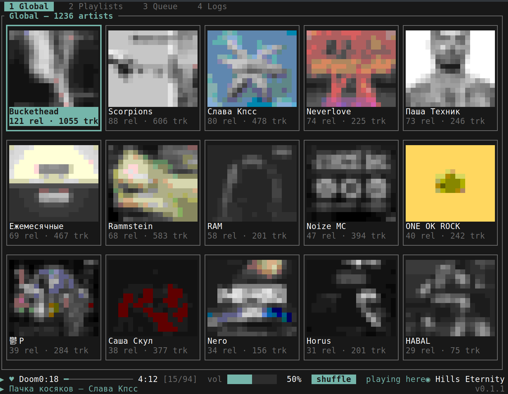

# furumi



**Your music. Your devices. Your network.**

Furumi is a federated P2P player for your personal music library. Every
running player is a complete, self-sufficient music library: it can import,
organize, search, and play your collection without an account, a cloud
backend, or a central service.

Connect Furumi on your desktop, laptop, or another device and they become one
personal music network. Playback, likes, playlists, and library state can move
between your devices, while missing tracks can be requested directly from
another player.

Furumi runs on **Linux, macOS, and Windows**.

## Why Furumi?

Music you own should not disappear because a subscription ended, a catalog
changed, a service was censored, or a server went offline.

Furumi is built around a different model:

- your library remains under your control;
- every player works independently;
- there is no central account or single point of failure;
- connecting more players improves availability instead of creating a new
  dependency;
- federation is optional and simple to configure.

A single Furumi instance is already useful. A group of instances becomes a
resilient network for your music.

## How it works

Each player maintains its own local library and publishes a searchable view of
it into Furumi's DHT network. Discovery does not depend on a central index.

Clients connect directly over P2P transport built on
[iroh](https://www.iroh.computer/). Furumi adds a synchronization protocol on
top of that transport to keep trusted devices consistent even when they are
not always online.

In practice:

1. Import music into any Furumi player.
2. Pair your other players or join a federation network.
3. Devices discover available libraries through the DHT.
4. Likes, playlists, playback state, and library metadata synchronize between
   trusted clients.
5. If a track is missing locally, Furumi can fetch it directly from another
   client.

There is no coordination server in the middle. Local players remain usable
when peers are offline, and the network becomes more capable as peers appear.

## The player

Furumi includes a full-featured terminal interface for browsing artists and
releases, searching, managing playlists and the queue, controlling playback,
inspecting connected devices, and configuring federation.

The interface supports keyboard-driven navigation, multi-key combinations,
context-aware bindings, and user-defined rebinding through TOML. Built-in
audio visualizations, OS media controls, gapless queue playback, and local
library management are included. Visualizations are runtime-loadable Rhai
scripts executed in a resource-limited sandbox, so they can be added or edited
without rebuilding the player.

Optional similarity search calculates versioned embeddings for local tracks
in the background and keeps them in SQLite. It works offline; after a separate
privacy consent it can also ask a bounded set of federation peers for matches.
Compatible peers are selected through signed, anonymous LSH summaries in a
decentralized DHT; no central recommendation index or shared calibration file
is required.
The first selectable model is downloaded on demand and is licensed separately
by MTG under CC BY-NC-SA 4.0 (a proprietary license is also available from
MTG); Furumi itself remains WTFPL.

## Install

### macOS

On Apple Silicon Macs, install Furumi from the Homebrew tap:

```bash
brew install house-of-vanity/tap/furumi
```

Run it with:

```bash
furumi
```

### Linux, Windows, and other platforms

Download a prebuilt archive from the
[GitHub releases](https://github.com/house-of-vanity/furumi_tui/releases), or
build Furumi from source with Rust 1.97 or newer:

The repository selects the stable Rust toolchain. With rustup, run
`rustup update stable` to install or update it before building.

```bash
cargo build --release --locked
./target/release/furumi
```

On Debian or Ubuntu, install the Linux audio build dependencies first:

```bash
sudo apt install libasound2-dev pkg-config
```

Equivalent ALSA development packages are required on other Linux
distributions. macOS and Windows require no additional system packages.

Import a music directory from Furumi's command line:

```text
:import /path/to/music
```

Federation, trusted-device pairing, and key bindings are configured directly
inside the player.

### Manual updates

In **Settings → Additional settings → Updates**, select **Check for updates**, then **Install update**
when a newer stable GitHub release is available. Downloads run in the background.
After installation, restart `furumi` to use the new version; playback is not
restarted automatically. Wait for an active update operation to finish before
quitting.

Updates replace the running executable in its installation directory, which
must be writable by your user. Release archives must include a matching entry
in the release's `SHA256SUMS` asset. Older releases without it cannot be installed
through this feature. The updater checks SHA-256 and the executable's format
and architecture before replacing it. Checksums provide integrity checking,
not publisher signatures. Settings and the local library are preserved.

There are no automatic startup checks. Only the existing release asset naming
scheme is supported; missing or incompatible platform builds are rejected.

The **Additional settings** window also contains the music save directory and
visualization controls. Use Up/Down (or j/k) to navigate, Enter to select, and
Esc to return to Settings. Long lists scroll with the selection.

### Tabs and key bindings

The number keys open the tabs in the order they are shown, and Tab /
Shift+Tab cycle through them:

| Key | Tab |
| --- | --- |
| `1` | Library |
| `2` | Playlists |
| `3` | Queue |
| `4` | Podcasts |
| `5` | Settings |
| `6` | Logs |

On narrow terminals the tab bar shortens titles and then shows only the
numbers, keeping the active tab's full name. Press `?` for the full list of
bindings and commands.

Bindings can be overridden in `keymap.toml` in the platform config directory
(`~/.config/furumi/keymap.toml` on Linux,
`~/Library/Application Support/furumi/keymap.toml` on macOS); the bundled
`src/config/default_keymap.toml` documents the format. Start the file with
`version = 2`, the current format: its `GoToTab` indices are used exactly as
written (`0` Library … `5` Logs). `version` must come before the first
`[[keymaps]]` entry; written after one, TOML would attach it to that entry, so
Furumi rejects such a file with an error instead of guessing. Files without `version` were written for the
older tab order (Settings and Logs on `4`/`5`, Podcasts on `6` in the
prototype podcast build); Furumi adapts their tab shortcuts in memory so they
keep opening the same tabs, shows a short notice at startup, and never
rewrites the file. Add `version = 2` once the indices match the new order to
take them literally and silence the notice.

### Podcasts

The Podcasts tab (`4`) follows RSS and Atom podcast feeds. Furumi stores only
the feed's episode information; audio stays on the publisher's server and is
never imported into the music library or offered to other peers.

- **Add podcast** (`o`, or the first row) takes a feed URL; `feed://`,
  `podcast://` and URLs without a scheme are accepted. Nothing is stored unless
  the URL serves a feed. New subscriptions are private.
- The list shows each podcast's unplayed and total episode counts and its
  check status; `!` marks a podcast whose last check failed, with the error in
  the side panel (or below the list on narrow terminals).
- `Enter` opens a podcast. Podcasts with seasons show their seasons first
  (plus "All episodes" and "Without a season"); `Esc` goes back.
- Episodes show the date, season/episode number, duration and listening
  state: `●` not started, `◐` in progress with the saved position, `✓` played.
  `/` searches titles and descriptions, `f` cycles all / unplayed / in
  progress / played, `Shift+S` changes the order, `m` marks the selected
  episode played or unplayed.
- `Shift+R` checks the selected podcast for new episodes, `Ctrl+R` checks all
  of them. Feeds are also checked in the background about once an hour with
  conditional requests; a failing feed is retried with growing pauses and its
  known episodes stay available. A permanent redirect moves the subscription
  to the new address.
- `Shift+U` (or `Shift+D`) unsubscribes after a confirmation. Listening
  progress and history are kept, so subscribing again continues where you
  left off.

Episodes play in the same queue as music:

- `Enter` on an episode plays it right after the current item and continues
  from the saved position; a played episode starts from the beginning. `b`
  ("start over") plays it from the beginning even when it is in progress.
  `a` / `Shift+A` queue episodes like tracks, and the queue can mix music and
  episodes.
- Audio streams from the publisher's server through a bounded buffer (about
  9 MB) and seeks with HTTP range requests. Nothing is downloaded ahead of
  time and nothing is kept after playback. If the server cannot seek (no
  file length), Furumi says that it cannot continue at the saved position
  instead of starting from the wrong place; "start over" still works, and
  seeking in such an episode is refused with a message. If the episode's
  address no longer works, the feed is checked once for a new one.
- If the connection is lost during an episode (no data for 30 seconds, or
  the address stops working), playback stops there: the position is saved,
  the episode is not marked played and the queue does not move on; play
  continues from that position. A pause pressed while an episode is still
  connecting is kept when the audio arrives.
- The position is saved every 20 seconds while playing and on pause, seek,
  stop, track change and exit. An episode counts as played within the last
  30 seconds (or 5 %) or when its stream reaches its end; a listen enters the episode's
  history when it completed or lasted at least 30 seconds. Seeking back and
  "start over" are real changes: an older save never moves the position
  forward again.
- Likes, playlists, music history, similarity search and share links are for
  music only and skip episodes; `Shift+J` on an episode opens its podcast.

Podcasts and your connected devices:

- **Private by default.** Subscriptions, episode progress and listening
  history are personal. They are synchronized only between your trusted
  devices (Connected Devices), never published to the federation: no DHT
  record, public catalog or search result contains them. Publishing a
  podcast for discovery is a separate, explicit choice that this version
  does not offer yet.
- **Synchronized between trusted devices.** A podcast you subscribe to on
  one device appears on the others without typing its URL again; each
  device then checks the feed itself. Unsubscribing, "played", the saved
  position and "start over" follow the same way, also through a device
  that relays them and after a device was offline for a while. When two
  devices played the same episode offline, they agree on one position and
  keep both listening sessions.
- **Handoff.** A queue with episodes moves to another device like music:
  the episode continues there at the handed-off position, paused or
  playing, even if that device is not subscribed. Devices that run an older
  Furumi (device sync before v4) cannot keep episodes: handing such a queue
  to them is refused with "needs a Furumi update", their remote control is
  ignored while the queue has episodes, and they get no podcast data: they
  see such a queue with "Private item" in place of each episode, so they
  keep seeing this device as the playing one. An older device still takes
  over when you choose it as the output (Play on it) or when it starts while
  this device is paused (`take_paused_on_startup`); this device then shows
  that device's queue, without the episodes (their saved positions stay).
- **Audio from the publisher.** Every device streams the episode from the
  publisher's server itself. Furumi peers never pass podcast audio to each
  other, and nothing is kept after playback.
- **Jam.** Guests see the host's episodes as "Private item" (no title, feed
  or address), cannot add episodes to the host's queue and cannot seek in a
  private item. They can still reorder the queue and skip.

Podcast data lives in `podcasts.sqlite3` in the platform data directory (the
same file the earlier podcast test build used; it is upgraded in place). If
that file was written by a newer Furumi or is not a podcast database, the tab
explains why it is unavailable and the file is left unchanged; podcast
changes from other devices then wait in the device-sync log until it opens.

### Now playing in tmux

While Furumi is running, a second invocation can print a cheap, single-line
playback snapshot without opening the TUI or library:

```bash
furumi --status
# ▶ Artist — Track 1:23/4:05
```

For example, add this to `.tmux.conf`:

```tmux
set -g status-interval 1
set -g status-right '#(furumi --status) | %H:%M'
```

`furumi --status-json` returns the same snapshot as JSON, including playback
state, title, artist, album, position, duration, and volume. Both commands
print nothing when Furumi is stopped or no track is loaded. On Linux, Furumi
also exposes the existing MPRIS player `cy.hexor.furumi`, which can be queried
with tools such as `playerctl`.

## Architecture

Furumi is a Rust application built with:

- `ratatui` and `crossterm` for the cross-platform TUI;
- `rodio` for local audio playback;
- SQLite for the personal library and synchronization state;
- tract ONNX inference for optional local music embeddings;
- a dedicated DHT for decentralized discovery;
- iroh-based P2P streams for client-to-client communication;
- an offline-tolerant operation log for trusted-device synchronization;
- Rhai for programmable audio visualizations.

More detail is available in [ARCHITECTURE.md](ARCHITECTURE.md).

## Contributing

Bug reports, design discussions, and patches are welcome. Before submitting a
change, run:

```bash
cargo fmt --all -- --check
cargo check --all-targets
cargo test --all-targets
```

## Playback coordination

Connected Devices uses the shared `music_dht::playback` engine from frid.
Newly started players take an idle/paused output after discovery and become
controllers when another device is playing. Missing output reports trigger
automatic failover; concurrent claims converge to one owner. The web gateway
uses a passive server profile and reports actual browser activity.

Only one TUI process may use a device identity. Installed and locally built
binaries use the same user data directory: close the installed player before
starting a development build. An OS file lock prevents duplicate coordinators
and is released automatically on exit or a crash. Older builds do not take
this lock, so close those explicitly when upgrading.

Connected-device polling runs independently per peer, so an offline or stalled
device does not postpone updates to live players.

The existing device menu handles manual transfers. Advanced policy can be set
in `settings.toml` without changing the UI:

```toml
[playback]
claim_on_startup = true
automatic_failover = true
take_paused_on_startup = true
discovery_ms = 3000
owner_timeout_ms = 120000
```

All clients must support the new coordination envelope for eventual single
output ownership. frid's `PLAYBACK_PROTOCOL.md` describes the protocol, adapter
contract and rollout. Local Cargo patches are only for development; publish
frid and bump the client dependency versions before releasing these changes.

Run the local protocol checks from the TUI repository:

```bash
cargo test localhost_devices_exchange_state_and_handoff
cargo test localhost_devices_sync_podcasts
cargo test devices::podcast_sync_tests
python scripts/test_device_interop.py ../furumusic
```

The first test uses real iroh streams, isolated SQLite databases, ownership
handoff, and a stalled peer. The podcast tests sync subscriptions, progress
and "start over" between TUI device stores (over iroh streams and through
the JSON messages), check a handoff with an episode and simulate a device
sync v3 peer with the exact JSON types of furumi-tui 0.3.x. The second builds both player test binaries and
exchanges their actual JSON messages over `127.0.0.1`: queue metadata,
bidirectional handoff, pause/seek and duplicate command fencing. It exercises
the TUI command adapter and web player hub, but does not start a browser or
PostgreSQL and does not cover web database migrations. Both tests use temporary
identities and data; no running player or user library is used.

## License

Furumi is released under the
[Do What The Fuck You Want To Public License, Version 2](LICENSE).
